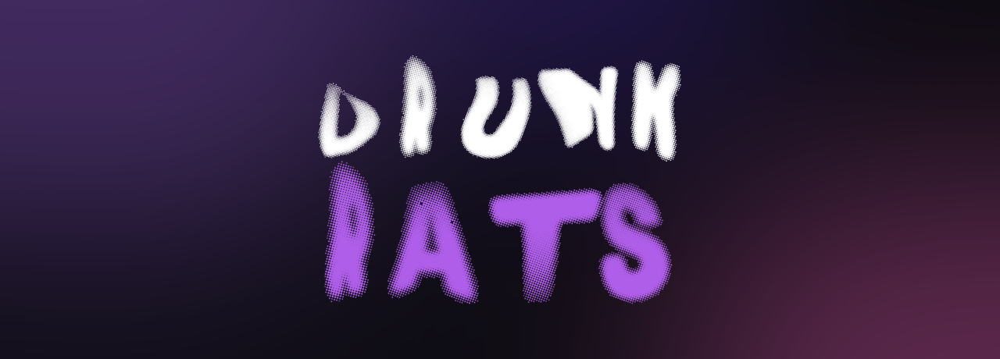

<div align="center">



**Transforme uma rodada de bebidas numa gincana competitiva.**
Sem cadastro, sem login, sem servidor — tudo roda no seu navegador.

<br>

[](https://react.dev)
[](https://www.typescriptlang.org)
[](https://vite.dev)
[](https://tailwindcss.com)
[](https://zustand.docs.pmnd.rs)
[](https://ant.design)

</div>

---

## Sobre

**DrunkRats** é uma SPA client-side para grupos de amigos que querem dar um ar de campeonato à noite. Você cadastra os jogadores, pontua cada bebida pelo teor alcoólico real, dispara eventos especiais com drinks sorteados de uma API pública e fecha a noite com um pódio.

O estado inteiro da partida vive no `localStorage` — recarregou a página, derrubou o celular, acabou a bateria? O jogo continua exatamente de onde parou.

| Princípio | O que significa |
|---|---|
| **Zero barreira** | Nenhum cadastro, login ou instalação |
| **Tolerância a falhas** | O progresso sobrevive a recarregamentos |
| **Portabilidade** | Qualquer navegador moderno, do celular ao desktop |
| **Limpeza** | Nova partida descarta os dados da anterior |

---

## Como funciona

```
  Home  ──►  Cadastro  ──►  Controle  ──►  Placar Final
   /         /players       /control        /scoreboard
                               │  ▲
                               ▼  │
                            Evento Drink
                              /drink
```

1. **Home** — apresentação, regras e avisos de bem-estar. Se existir partida salva, aparecem os botões **Continuar** e **Nova Partida**.
2. **Cadastro** — nome (único, 2+ caracteres) e cor (única) por jogador. O botão de iniciar só libera com **2 ou mais jogadores**.
3. **Controle** — o coração do jogo: adicionar e remover pontos, calcular pontuação por ml × teor alcoólico, salvar presets, marcar desistências.
4. **Evento Drink** — sorteia um drink aleatório, define um vencedor e aplica o bônus. Ou pula, e todo mundo ativo perde 5 pontos.
5. **Placar** — ranking ao vivo durante a partida, pódio e histórico de eventos no fim.

---

## Rodando localmente

**Pré-requisitos:** Node.js 20+ e npm.

```bash
git clone https://github.com/Lywhena/drunkrats.git
cd drunkrats
npm install
npm run dev
```

A aplicação sobe em `http://localhost:5173`.

### Scripts

| Comando | O que faz |
|---|---|
| `npm run dev` | Servidor de desenvolvimento com HMR |
| `npm run build` | Checagem de tipos (`tsc -b`) + build de produção |
| `npm run preview` | Serve o build de produção localmente |
| `npm run lint` | ESLint em todo o projeto |

---

## Rotas

Todas as rotas de partida são protegidas por guards que leem o `status` do store e redirecionam sozinhas quando o acesso não faz sentido.

| Rota | Tela | Acesso permitido | Redireciona para |
|---|---|---|---|
| `/` | Home | sempre | — |
| `/players` | Cadastro de Jogadores | `setup` | `/` ou `/control` |
| `/control` | Controle de Pontuação | `playing` | `/` ou `/scoreboard` |
| `/scoreboard` | Placar | `playing` ou `finished` | `/` |
| `/drink` | Evento Drink | `playing` | `/control` |
| `*` | — | — | `/` |

### Ciclo de vida da partida

```
idle ──startGame()──► setup ──iniciar──► playing ──finishGame()──► finished
  ▲                                                                    │
  └──────────────────────── resetGame() ───────────────────────────────┘
```

---

## Regras de pontuação

**Cálculo por bebida** — `src/shared/lib/scoring.ts`

```ts
calcScore(ml, abv) = Math.round(ml × (abv / 100))
```

> Uma long neck de 355 ml a 5% vale **18 pontos**. Uma dose de 50 ml a 40% vale **20 pontos**.

**Bônus do evento drink** — derivado do nome do drink sorteado, limitado à faixa de **10 a 30 pontos**.

**Penalidade de skip** — pular um evento custa **−5 pontos** a todos os jogadores ativos.

> A pontuação **nunca** fica negativa. Todas as subtrações têm piso em zero.

### Presets

O valor calculado pode ser salvo com um nome (`"Heineken Long Neck"`, `"Dose de Vodka"`) e reutilizado em um clique. Presets são persistidos **separadamente da partida** — sobrevivem a um `resetGame()` e continuam disponíveis na próxima noite.

---

## Evento Drink

Integração com a [TheCocktailDB](https://www.thecocktaildb.com) — API pública, gratuita, sem autenticação.

```
GET https://www.thecocktaildb.com/api/json/v1/1/random.php
```

O card exibe nome, foto, categoria e ingredientes com suas medidas. Se a API falhar, estiver fora do ar ou o grupo simplesmente não tiver os ingredientes, há sempre o **fallback**: um shot de destilado de 50 ml. É a única parte do app que precisa de internet — cadastro, controle e placar funcionam offline.

---

## Arquitetura

SPA inteiramente client-side, organizada em **vertical slices** por feature.

```
src/
├── app/              # Composição global
│   ├── assets/       # Imagens e background animado
│   ├── docs/         # PRD e design document
│   └── router/       # Rotas + guards
├── modules/          # Features isoladas
│   ├── control/      # Pontuação, calculadora de ml, histórico
│   ├── drink/        # Evento de drink aleatório
│   ├── home/         # Landing e entrada no fluxo
│   ├── layout/       # NavBar e fundo animado
│   ├── players/      # Cadastro de jogadores
│   ├── presets/      # Tipos dos presets de pontuação
│   └── scoreboard/   # Ranking, pódio e tabela
└── shared/           # Transversal e reutilizável
    ├── components/   # PlayerAvatar
    ├── lib/          # scoring, cocktaildb
    └── store/        # useGameStore, usePresetsStore
```

**Regra de dependência:** `modules/` importa de `shared/`. `shared/` **nunca** importa de `modules/`. `app/` importa dos dois, apenas para compor.

### Path aliases

Configurados em `vite.config.ts` e `tsconfig.json`. Nada de `../../../`.

| Alias | Resolve para |
|---|---|
| `@` | `src/` |
| `@modules` | `src/modules/` |
| `@app` | `src/app/` |
| `@shared` | `src/shared/` |

### Estado

Dois stores Zustand com middleware `persist`:

- **`useGameStore`** — jogadores, pontuação, eventos e `status` da partida. Descartado a cada `resetGame()`.
- **`usePresetsStore`** — presets de pontuação nomeados. Independente da partida.

### Identidade visual

| Token | Cor | Uso |
|---|---|---|
| `--bg` | `#13111a` | Fundo |
| `--surface` | `#1e1b29` | Cards e containers |
| `--accent` | `#9b5de5` | Ação primária |
| `--accent-2` | `#c084fc` | Roxo claro |
| `--text-h` | `#ede9f7` | Texto primário |
| `--text` | `#8b80a8` | Texto secundário |
| `--border` | `#2d2840` | Divisores |

---

## Documentação

| Documento | Conteúdo |
|---|---|
| [`drunkrats-prd.md`](src/app/docs/drunkrats-prd.md) | Requisitos de produto, telas, regras de negócio e modelo de dados |
| [`design-doc.md`](src/app/docs/design-doc.md) | Arquitetura, máquina de estados, contratos e convenções |
| [`CLAUDE.md`](CLAUDE.md) | Convenções do repositório para assistentes de código |

---

## Autores

Helena Veltri · Leandro Retzlaff · Rayanna Christensen · Bernardo Grams

---

<div align="center">

### Beba com responsabilidade

Este é um projeto de brincadeira entre amigos. Conheça seus limites, beba água,
não dirija depois de beber e cuide de quem está junto.
Ninguém ganha nada ficando doente.

<br>


</div>
